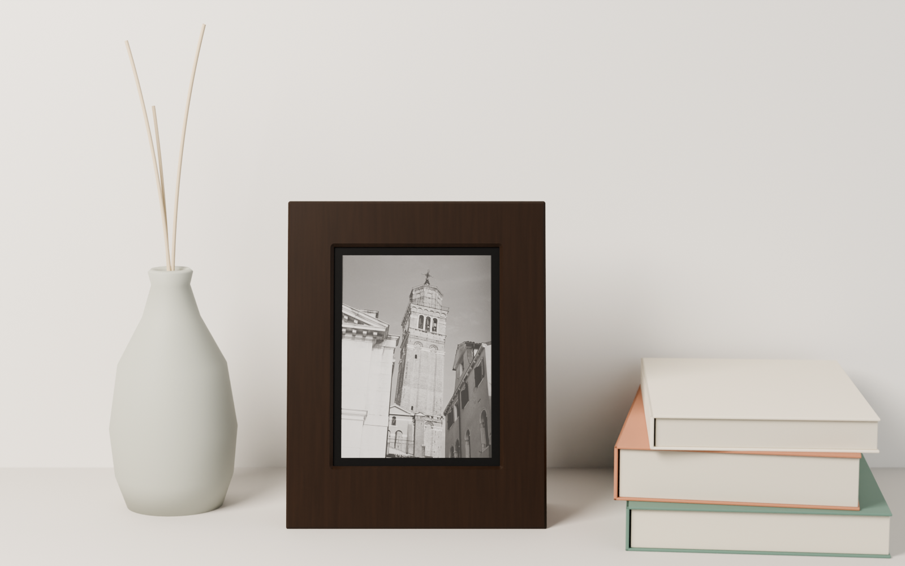
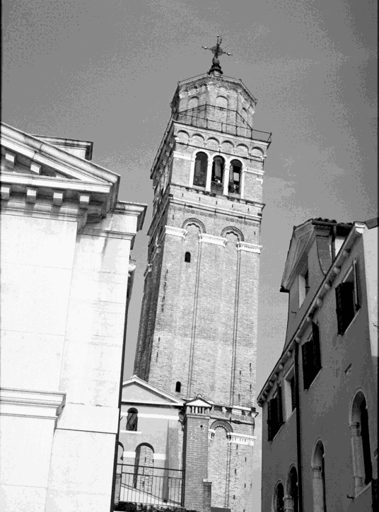
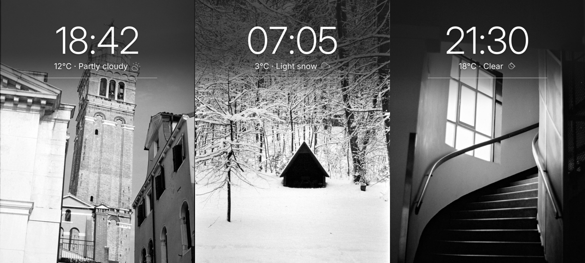
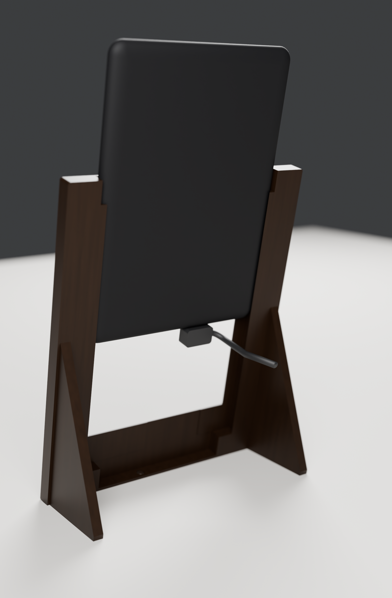

# Film Frame

Your film photos on a device you already own. Film Frame turns a Kindle Paperwhite 4 (10th gen, 2018) into an e-ink picture frame: one photograph at a time, no glow, no cloud. The photos live on the Kindle, and e-ink holds the picture without drawing power.



## The story

**Your scans.** `tools/prep-photos.sh` turns film scans into 1072 × 1448 grayscale frames for the Kindle's 300 ppi screen. They stay on the Kindle; nothing gets uploaded.

**On your Kindle.** A jailbroken Paperwhite runs the frame app and shows a new photo every 30 minutes. Tap the screen and a clock with the weather fades in over a dark band at the top, holds for six seconds, then fades out; a flashing full refresh clears the ghosting and the bare photo returns. Nothing moves until you touch it or the next photo is due.





**In a frame you print.** Two walnut stands hide the Kindle except a 5 mm black line around the photo, so the logo stays covered, and both hide the charger cable. Each is one printed part: no screws, no glue, no back panel.

| Gallery | Bot |
|---|---|
|  |  |
| A walnut box frame. A 45° bevel steps down to the screen, and two feet behind the side walls hold it at 12°. | Shaped like the Claude Code bot: arms beside the photo, four legs as feet. |
|  |  |
| A 90° micro-USB plug turns along the bottom rail; the cable runs inside the rail and leaves through the back. | A straight plug drops into a hollow leg; the cable leaves through the back of its foot. |

The Kindle drops in from the top. Channels in the side walls follow its own rounded edges, so it slides down and stands on the bottom rail; lips behind its widest point keep it from falling out backward, and its own back closes the frame:



Print files and notes for whoever prints them: [frame/PRINTING.md](frame/PRINTING.md).

## Using it

| Gesture | Effect |
|---|---|
| Tap | show the clock and weather; tap again to hide early |
| Swipe left / right | next / previous photo |
| Power button | wake a sleeping frame and show the clock; when awake, same as a tap |
| Hold a finger still for 3 s | leave the frame, back to the Kindle Home screen |

With `power_mode = auto` (see Battery) the frame sleeps between photos on battery, so press the power button first, then tap or swipe.

Photos change every 30 minutes in shuffle order: each one once, in random order, then a new shuffle. The position survives restarts. Set `order = random` or `order = name` in the config to change that.

Start it from KUAL > Film Frame > Start frame. If the screen ever stops reacting, hold the power button for about 40 seconds: the Kindle restarts into its normal UI, because the frame never starts on its own.

## Files on the Kindle

```
/mnt/us/extensions/filmframe/   KUAL menu, bin/filmframe, bin/run.sh
/mnt/us/filmframe/filmframe.conf settings (edit over USB)
/mnt/us/filmframe/photos/       the frames
/mnt/us/filmframe/state/        playlist position, last weather
/mnt/us/filmframe/filmframe.log what happened, with battery level per photo
```

## Setup

You need a jailbroken Kindle with KUAL; the hotfix puts FBInk at `/mnt/us/libkh/bin/fbink`, which the frame finds on its own. See [JAILBREAK.md](JAILBREAK.md) for that part.

```sh
# 1. turn scans into 1072x1448 grayscale JPEGs (q80, light sharpening)
tools/prep-photos.sh photos/source/scans photos/kindle-frames
# 2. build and copy onto the mounted Kindle
tools/install.sh /Volumes/Kindle photos/kindle-frames
```

`prep-photos.sh` fills the screen with portrait shots (a centre crop loses at most 12%) and puts landscape shots on a black mat. It stretches contrast per image, which rescues thin negatives (`STRETCH=0` turns that off), and leaves out the frames listed in `tools/skip.txt`. Environment knobs: `QUALITY`, `MAT`, `MAX_CROP`, `SHARPEN`, `JOBS`.

To see the touch sequence without a Kindle:

```sh
cd filmframe && go run . -config /dev/null -preview /tmp/pv -photo ../photos/kindle-frames/000001.jpg
```

## Settings

`filmframe.conf` documents every key. The ones you are likely to touch: `photo_minutes`, `order`, `hold_seconds`, `latitude`/`longitude`/`timezone` (example: London; set your own), `units`, `clock = 12h`, `frontlight`.

## Battery

The frame stays awake by default (`power_mode = awake`) and is meant to run on a charger, which both stands hide. Sleeping can hand the screen to the Kindle's own screensaver, and on ad-supported Kindles that shows ads. If you need battery life, `power_mode = auto` sleeps between photos:

- **On battery** it draws a photo, arms the RTC alarm for the next change and suspends to RAM. The photo stays on screen. The alarm wakes it, it draws the next photo and sleeps again. Weather refreshes on those wakes, at most hourly.
- **Press the power button** to wake it: the clock and weather show at once, taps and swipes work for a minute, then it sleeps again. Taps alone can't wake a sleeping Kindle.
- **On a charger** (or the Mac's cable) it stays awake, so taps work instantly.
- At 4% it shows "Battery low · Please charge" and sleeps until the power button.
- The front light is off while the frame runs; your own level returns when you leave.

Wake-ups use both PW4 RTCs (`/sys/class/rtc/rtc{0,1}/wakealarm`, relative form) and `mem` into `/sys/power/state`. Every photo change logs the battery level, so the drain rate shows up in `filmframe.log`.

## How it works

`filmframe` is one static Go binary. `run.sh` pauses the stock UI the way KOReader does on firmware 5.x (pillow off, `awesome` and `volumd` frozen, a few services stopped, including the OTA updater) and restores all of it when the frame exits. The binary grabs the touchscreen exclusively, composites the overlay in memory, and dithers it to the panel's 16 gray levels with an ordered 8x8 pattern. The pattern depends only on pixel position, so pixels that did not change dither identically and each partial update leaves no seam. Only the changed rectangle goes to FBInk: the fade steps cover the top 585 rows, the rule steps a 2-pixel strip. Weather comes from Open-Meteo (no key); the server's Date header also corrects a drifted Kindle clock.

## Frame stands (3D print)

`frame/` builds both stands in Blender from the numbers at the top of each script. Print files, renders and dimensions sit in `frame/print/` (bot) and `frame/print/gallery/` (gallery); [frame/PRINTING.md](frame/PRINTING.md) has the settings, hardware and assembly. Rebuild after changing a number:

```sh
cd frame
blender -b -P build_frame.py -- print --render --check             # bot
blender -b -P build_gallery.py -- print/gallery --render --check   # gallery
uv run --with trimesh --with networkx --with lxml --with scipy python check_print.py print/gallery
uv run --with trimesh --with networkx --with lxml --with scipy python check_print.py print
```

`check_print.py` reports, for every part, whether it is watertight and one body, and its widest unsupported overhang. `--check` renders each front in flat colours from 18 angles and proves the Kindle's logo stays hidden (`visibility.txt`).

## Legal

This repo holds the frame app, the stand designs and helper scripts. It holds no jailbreak or circumvention code: the jailbreak is third-party ([KindleModding](https://github.com/KindleModding)'s WinterBreak2), and [JAILBREAK.md](JAILBREAK.md) describes using it on a Kindle you own. The frame shows your own photos and does not touch Kindle books, DRM or Amazon's ads. Jailbreaking your own device is broadly allowed in the EU; in the US, dedicated e-readers have no DMCA jailbreak exemption, so check the law where you live. Kindle is a trademark of Amazon.com, Inc., and Claude Code is a trademark of Anthropic; this project is not affiliated with either.

## Licenses

Code, scripts and the frame stand designs: MIT ([LICENSE](LICENSE)). Inter typeface: SIL Open Font License (`filmframe/assets/Inter-LICENSE.txt`). Weather icons: Lucide, ISC (`filmframe/assets/icons/LICENSE.txt`). Sample photos: film photographs by the repository owner, shown here as samples and not covered by the MIT licence ([samples/SOURCES.md](samples/SOURCES.md)). Go modules fetched at build time: BSD-3-Clause (`golang.org/x/...`, `srwiley/oksvg`, `srwiley/rasterx`).
