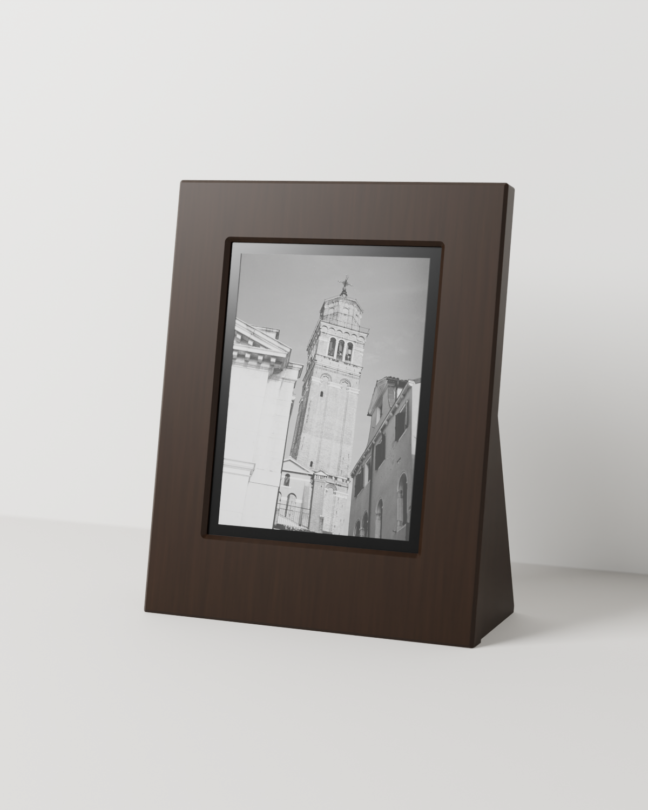
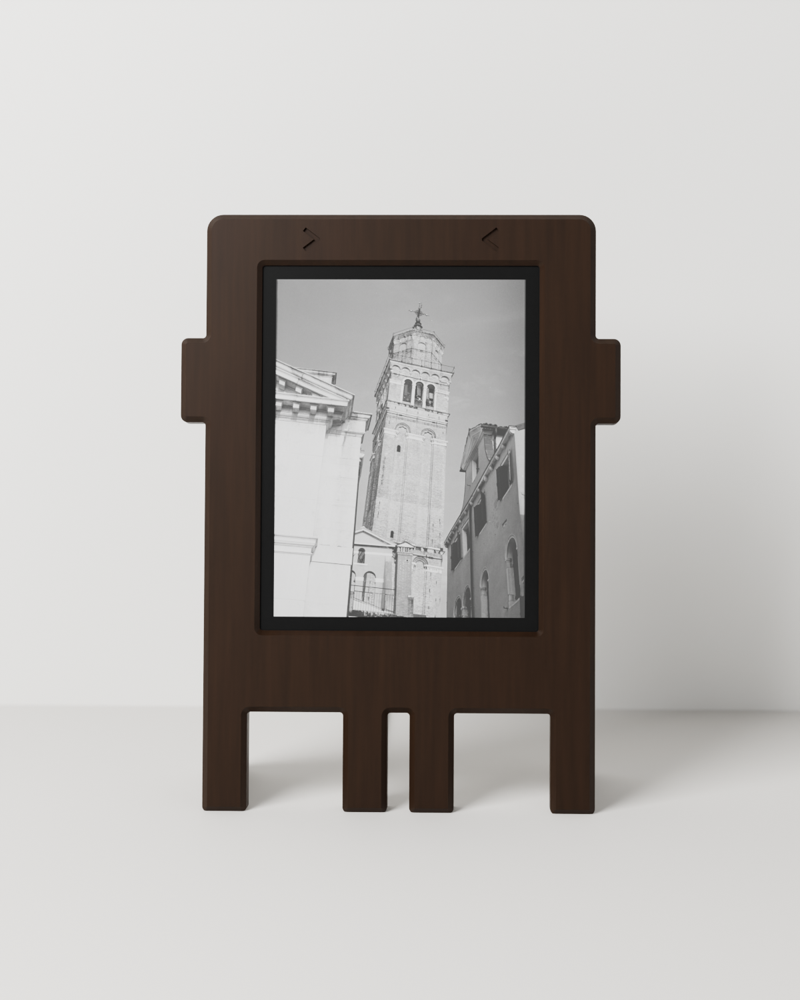
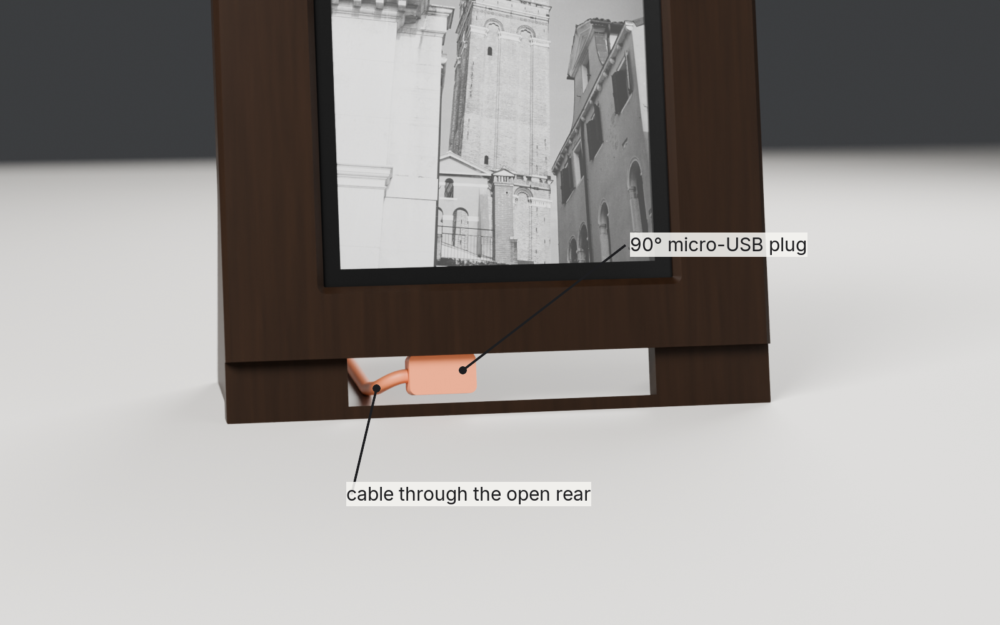
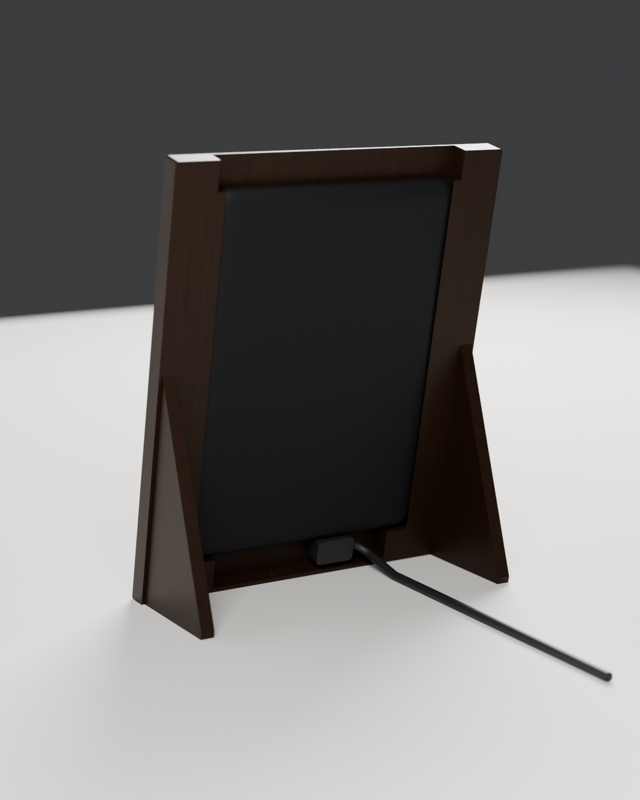
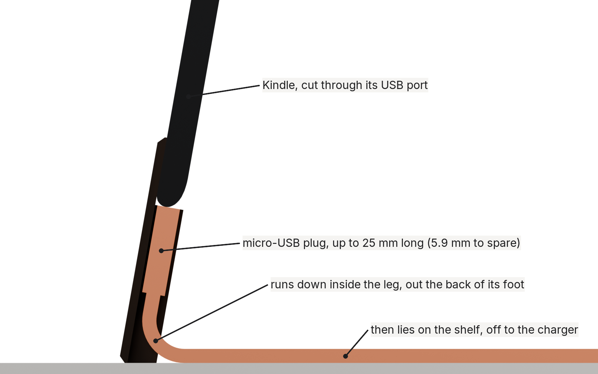
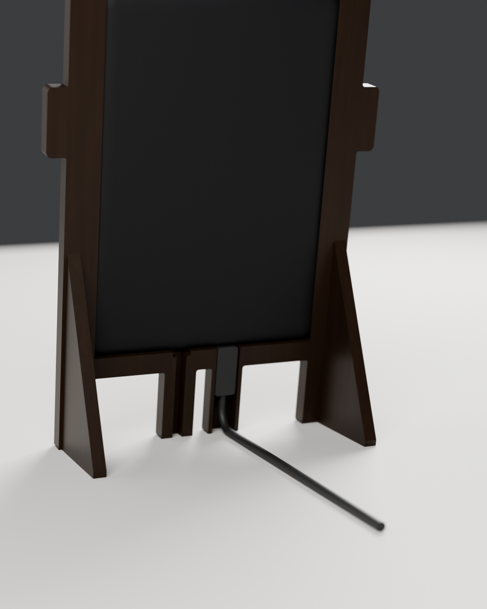

# Film Frame stands: print notes

Two stands for a **Kindle Paperwhite 4 (10th gen, 2018, model PQ94WIF)**, in dark walnut. Both cover the Kindle's black front and both hide the charger cable. Pick one:

| | Gallery | Bot |
|---|---|---|
| |  |  |
| Look | box frame, white mat 5 mm behind the wood | the Claude Code bot: arms and four legs |
| Files | `print/gallery/` | `print/` |
| Cable | micro-USB with a 90° left- or right-angled plug | micro-USB with a straight plug up to 25 mm |
| Size | 154.6 × 198.0 mm, 18 mm deep | 159.5 × 216.5 mm, 14 mm deep |
| Bed | 210 × 210 mm | 256 × 256 mm, or 250 × 210 with the part turned 90° |
| Filament | 167 g walnut, 17 g white | 165 g walnut (11 g white for the mat option) |

## Settings (both stands)

- **Filament:** dark walnut wood-fill PLA, or plain PLA in walnut brown; white or paper-coloured PLA for a mat. A 0.6 mm nozzle is safest with wood fill; 0.4 works.
- 0.2 mm layers, 3 walls, 15% gyroid infill, **no supports, no brim**. Print **one part per plate**.
- STL and 3MF files are equivalent (millimetres), and each is laid flat in its print orientation: fronts and mats face down, backs inner side down with the fins up.
- The fronts print face down, so the bed surface becomes the visible face: textured PEI gives a soft matte finish, smooth PEI a satin one. The face edges are 45° chamfers rather than rounds, so the first layers don't sag.
- Filament weights and times below come from PrusaSlicer at these settings with a generic, slow printer profile; a fast printer needs much less time.
- Run `check_print.py` (below) after any change: every part should report watertight, one body, and no "needs supports" line.

## Gallery frame

| Part | File | Colour | Print | Filament, time |
|---|---|---|---|---|
| Front | `gallery-front` (STL or 3MF) | walnut | face down | 80 g, about 7 h |
| Mat | `gallery-mat` | white | viewer side down | 17 g, about 2 h |
| Back | `gallery-back` | walnut | inner side down, fin up | 87 g, about 10 h |

**Hardware**

- 4 × M3 × 10 countersunk screws (they self-tap into the 2.5 mm pilot holes), or 3.0 × 10 mm plastic or wood screws.
- A micro-USB cable with a **90° angled plug**: the cable leaves the plug sideways, along the Kindle's bottom edge (Lindy makes these, among others). The bottom rail holds a plug head up to 11.5 mm tall and 8.8 mm thick, reaching up to 20 mm to either side of the port. Best: a plug whose cable runs **left** when you look at the frame from the front, because it stays clear of the power-button hole. One that runs right also fits; the cable then lies over that hole.
- Optional: felt pads on the back plate if the Kindle rattles.

**Assembly**

1. Lay the front face down. Drop the mat in with its bevel down: on the finished frame the bevel faces you.
2. Put the Kindle in screen down on the mat, its USB port toward the bottom rail.
3. Plug the cable in and lay it along the floor of the rail, toward the side the plug points. The back plate has a notch above each end of the rail; the cable leaves through the one on its side.
4. Put the back on with the cable in its notch and screw it down gently; the screws only hold the Kindle against the front.
5. Stand the frame up. It leans back 12° on the fin, and the cable lies on the shelf behind it, out to the charger.



**Power button:** it sits on the Kindle's bottom edge inside the rail. To press it, tilt the frame back and push a pen up through the 5 mm hole in the bottom. The frame never sleeps, so you'll rarely need it.



## Bot stand

| Part | File | Print | Filament, time |
|---|---|---|---|
| Front | `front-classic` (STL or 3MF) | face down | 74 g, about 7 h |
| Back | `back` | inner side down, kickstand fins pointing up | 91 g, about 10 h |

Optional instead of the black line: `front-mat` (62 g) plus `mat` (11 g), a passe-partout printed in white or paper-coloured PLA (`render-walnut-mat.png`). Its window has a 45° bevel like a hand-cut mat, overlaps the image by 1 mm so no black bezel shows, and its bottom margin is wider than the sides. The engraved `>` `<` eyes on the front are bridged at 0.8 mm.

**Hardware**

- 4 × M3 × 10 countersunk screws (they self-tap into the 2.5 mm pilot holes), or 3.0 × 10 mm plastic or wood screws. Longer screws bottom out before the head seats.
- A micro-USB cable. A straight plug up to **25 mm** long fits; a 90° plug that points backward is neater.
- Optional: felt pads on the back plate if the Kindle rattles (the pocket is 117.5 × 167.8 × 8.5 mm for a 116.7 × 167 × 8.18 mm Kindle), and rubber feet under the legs.

**Assembly, and where the charger goes**



1. Lay the front face down. Put the Kindle in screen down, its bottom edge (with the USB port) toward the legs.
2. **Plug the cable in now**, while the back is off. The plug points down into the hollow **left inner leg** (seen from the front), which sits right under the port.
3. Run the cable down that leg's channel and out through the **small slot at the back of its foot**. Put the back on and screw it down gently; the screws only hold the Kindle against the front.
4. Stand the frame up. From the front nothing shows: the cable leaves behind the leg and lies on the shelf, out to the charger.



**Power button:** it sits on the Kindle's bottom edge above the right inner leg. A pocket in the rail keeps the Kindle's weight off it (the button sticks out 0.6 mm). To press it, tilt the frame back and push a pen up through the 5 mm hole in the bottom of that leg. The frame never sleeps, so you'll rarely need it.

## Where the numbers come from

- Kindle body: Amazon's spec (167 × 116 × 8.18 mm) and a measured, public-domain STEP model (Printables #1061750, 116.7 mm wide).
- Screen image: 90.6 × 122.4 mm (E Ink 6" 1072 × 1448 panel datasheets), centred left-right; its bottom edge sits 24.4 mm above the Kindle's bottom edge (STEP model).
- Micro-USB at 46.35 mm and power button at 70.35 mm from the Kindle's left edge (STEP model).
- Gallery: the mat shows 13 mm of white at the sides and top and 19 mm at the bottom, like a hand-cut mat, and its window overlaps the image by 1 mm so no black bezel shows. The Kindle stands on 14 mm pads at both ends of the bottom rail; the cable space between them is 14 mm tall and 12 mm deep, and its floor stays at least 2 mm thick above the leaned shelf. `build_gallery.py` asserts these, the face lip over the pocket, the screw depths and the bed size on every build.
- Bot leg layout: the micro-USB port and power button sit mirrored, 12 mm either side of the Kindle's centre, so the two inner legs sit right under them and the bot stays symmetric.
- Bot leg height: a 25 mm straight plug, a 10 mm cable bend and the 10° lean leave 5.9 mm above the shelf. `build_frame.py` checks this on every build and stops if a change breaks it.

Want to check the window before printing it all? In the slicer, stop the front after 3 mm (about 15 minutes), lay it over the Kindle, and look at the border. Every number lives at the top of `build_gallery.py` and `build_frame.py`:

```sh
blender -b -P build_gallery.py -- print/gallery --render   # gallery parts and renders
blender -b -P build_frame.py -- print --render             # bot parts and renders
uv run --with trimesh --with networkx --with lxml --with scipy python check_print.py print/gallery
uv run --with trimesh --with networkx --with lxml --with scipy python check_print.py print
```
