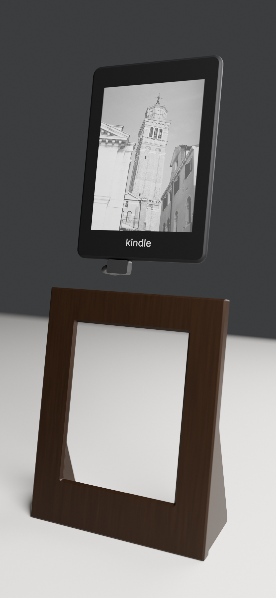
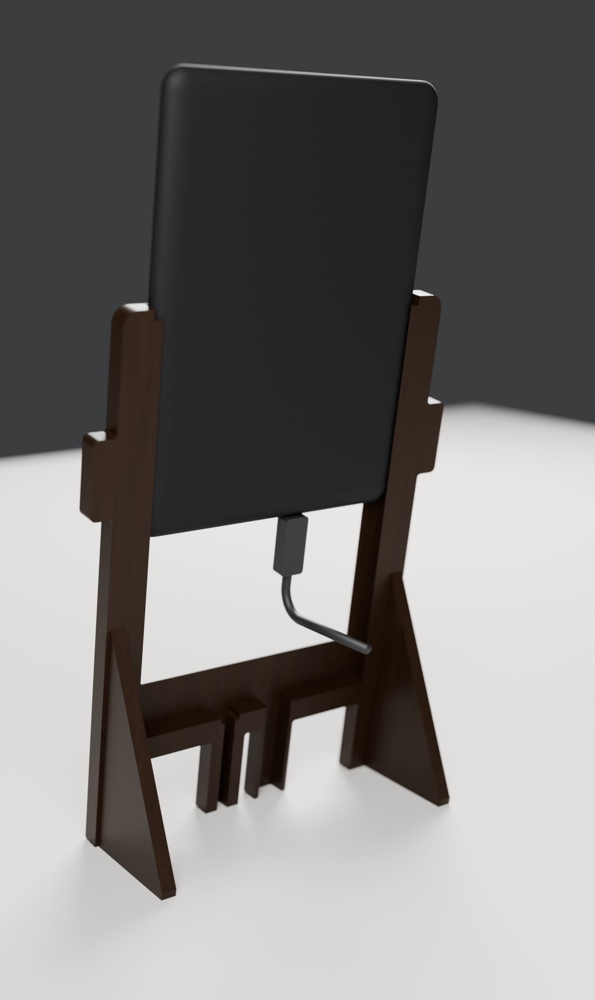

# Film Frame stands: print notes

Two stands for a **Kindle Paperwhite 4 (10th gen, 2018, model PQ94WIF)**, in dark walnut. Both cover the Kindle's black front except a 5 mm black line around the image, so the "kindle" logo stays hidden, and both hide the charger cable. Each stand is **one printed part**: no screws, no glue, no back panel. The Kindle slides in from the top along channels shaped like its own rounded edges.

| | Gallery | Bot |
|---|---|---|
| |  |  |
| Look | box frame, 45° bevel down to a 5 mm black line | the Claude Code bot: arms and four legs |
| File | `print/gallery/gallery-front` | `print/front` |
| Cable | micro-USB with a 90° plug | micro-USB with a straight plug |
| Size | 156.6 × 198.2 mm, 11.2 mm deep, leans back 12° | 159.3 × 216.4 mm, 10.6 mm deep, leans back 10° |
| Bed | 210 × 210 mm | 256 × 256 mm, or 250 × 210 with the part turned 90° |
| Filament | 75 g, about 7 h | 68 g, about 6.5 h |

## How it goes together


The Kindle drops in through a slot in the top of the frame. Channels in the side walls follow the curve of its edges with 0.3 mm of play, and a lip behind its widest point reaches 3.2 mm inside its outline, so it cannot fall out backward. It stands on the bottom rail by gravity, and its own back closes the frame.

1. Plug the cable into the Kindle first.
2. Stand the frame on its feet. Hold the Kindle screen forward above the top slot, with the cable hanging behind it.
3. Lower it into the slot and let it slide down until it stands on the bottom rail. The plug rides down with it and ends in the cable space (see each stand below).
4. Lay the cable straight back out of the open back.

To take the Kindle out, push it up from behind through the open back and lift it out of the top slot.



## Settings (both stands)

- **Filament:** dark walnut wood-fill PLA, or plain PLA in walnut brown. A 0.6 mm nozzle is safest with wood fill; 0.4 works.
- 0.2 mm layers, **2 walls, 10% gyroid infill, 3 bottom and 4 top solid layers, no supports, no brim**. These settings use about a quarter less filament than 3 walls and 15% infill and print about 2 hours faster, with the same look: the visible face is the first layer on the bed, and the top layers only cover hidden surfaces. For the least filament, lightning infill brings the parts to 64 g and 58 g; it leaves the thick walls nearly hollow inside.
- STL and 3MF files are equivalent (millimetres), and each is laid flat in its print orientation: face down, feet and lips pointing up.
- The bed surface becomes the visible face: textured PEI gives a soft matte finish, smooth PEI a satin one. The face edges are 45° chamfers rather than rounds, so the first layers don't sag.
- If the Kindle binds in the channels, sand the inside of the lips lightly; if it rattles, a strip of thin felt on each lip takes up the play.
- Weights and times come from PrusaSlicer at these settings with a generic, slow printer profile; a fast printer needs much less time.
- Run `check_print.py` (below) after any change: every part should report watertight, one body, and no "needs supports" line.

## Gallery frame

**Cable.** Use a micro-USB cable with a **90° angled plug**: the cable leaves the plug sideways, along the Kindle's bottom edge (Lindy makes these, among others). The plug rides into the frame inside the Kindle's outline, so its head must be **no thicker than 8 mm**; it can be up to 11.5 mm tall and reach up to 20 mm to either side of the port. Measure yours. Best is a plug whose cable runs **left** when you look at the frame from the front, because it stays clear of the power-button hole. The plug ends in the cavity in the bottom rail, and the cable leaves out of the open back.


**Power button:** it sits on the Kindle's bottom edge inside the rail. To press it, tilt the frame back and push a pen up through the 5 mm hole in the bottom. The frame never sleeps, so you'll rarely need it.


## Bot stand

The engraved `>` `<` eyes on the front are bridged at 0.8 mm.

**Cable.** A straight micro-USB plug fits if its body is at most **25 mm** long and **10.5 × 6.5 mm** in cross-section; measure yours. As the Kindle slides down, the plug drops into the hollow **left inner leg** (seen from the front), which sits right under the port; the cable leaves out of the back of that leg, out of sight from the front.


**Power button:** it sits on the Kindle's bottom edge above the right inner leg. A pocket in the rail keeps the Kindle's weight off it (the button sticks out 0.6 mm). To press it, tilt the frame back and push a pen up through the 5 mm hole in the bottom of that leg.



## Building it in wood

The shapes work for a woodworker too: a frame with a sight opening and a 45° bevel, side stiles with a channel routed to the Kindle's edge curve and a 45° lip behind it, an open slot in the top rail, feet tenoned into the side stiles, and a cable groove in the bottom rail (gallery) or the left inner leg (bot). `dimensions.txt` next to each file lists every measurement, including the edge profile.

## Where the numbers come from

- Kindle body: sections of the STEP model ["Kindle Paperwhite 10th Gen (2018)" by chairmanwon (Printables #1061750)](https://www.printables.com/model/1061750-kindle-paperwhite-10th-gen-2018), cut with OpenCascade: 116.7 × 166.6 × 7.85 mm. Every edge has the same curve: widest 3 mm behind the glass, sweeping 7.8 mm inward to the flat back. The corners have an 8 mm radius seen from the front. Amazon's spec gives 167 × 116 × 8.18 mm.
- Screen image: 90.6 × 122.4 mm (E Ink 6" 1072 × 1448 panel datasheets), centred left-right; its bottom edge sits 24.4 mm above the Kindle's bottom edge.
- Micro-USB at 46.35 mm and power button at 70.35 mm from the Kindle's left edge.
- Logo: the top of the "kindle" wordmark sits 6.5 mm below the image, measured on a photo of the owner's Kindle with the screen's 90.6 mm width as the scale (the same photo gives the screen height as 123.3 mm against 122.4 in the datasheet). The 5 mm black line leaves 1.5 mm. Both builders take `--check`: it renders the front in flat colours from 18 angles (straight on, then 30° and 45° up, down, left and right, with the Kindle shifted to either side of its play) and counts visible logo pixels. Every view shows zero; the results are in `visibility.txt` next to each file.
- Stability: with the Kindle in, the centre of mass sits 26 to 37 mm inside the footprint of the front edge and the feet, in both directions, for both stands.
- Fit: both builders model the Kindle and the plug sliding down the channel and assert that nothing collides on the way in.
- Bot: the micro-USB port and power button sit mirrored, 12 mm either side of the Kindle's centre, so the two inner legs sit right under them. A 25 mm straight plug, a 10 mm cable bend and the 10° lean leave 5.9 mm above the shelf.

Want to check the window before printing it all? In the slicer, stop the part after 3 mm (about 15 minutes), lay it over the Kindle, and look at the border. Every number lives at the top of `build_gallery.py`, `build_frame.py` and `kindle_profile.py`:

```sh
blender -b -P build_gallery.py -- print/gallery --render --check   # gallery part, renders, logo check
blender -b -P build_frame.py -- print --render --check             # bot part, renders, logo check
uv run --with trimesh --with networkx --with lxml --with scipy python check_print.py print/gallery
uv run --with trimesh --with networkx --with lxml --with scipy python check_print.py print
```
