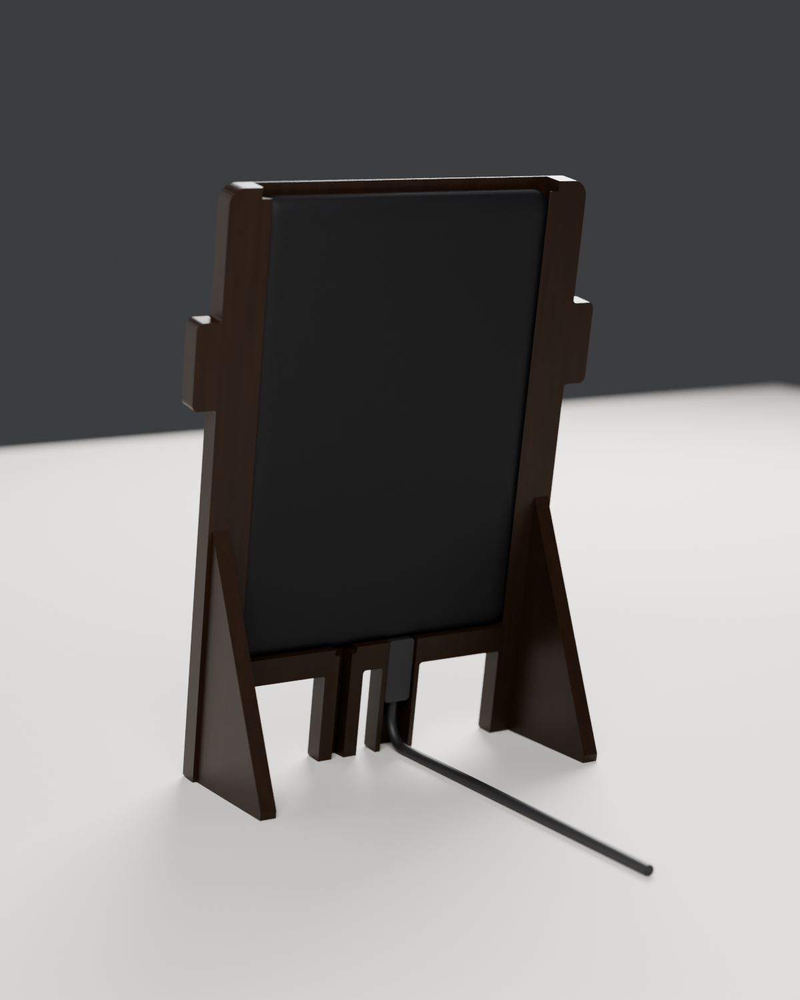

# Film Frame stands: print notes

Two stands for a **Kindle Paperwhite 4 (10th gen, 2018, model PQ94WIF)**, in dark walnut. Both cover the Kindle's black front except a 5 mm black line around the image, so the "kindle" logo stays hidden, and both hide the charger cable. Each stand is two printed parts: no screws, no glue.

| | Gallery | Bot |
|---|---|---|
| |  |  |
| Look | box frame, 45° bevel down to a 5 mm black line | the Claude Code bot: arms and four legs |
| Files | `print/gallery/`: `gallery-front`, `gallery-back` | `print/`: `front`, `back` |
| Cable | micro-USB with a 90° plug | micro-USB with a straight plug up to 25 mm |
| Size | 156.6 × 198.2 mm, 14.5 mm deep, leans back 12° | 159.5 × 216.5 mm, 13.9 mm deep, leans back 10° |
| Bed | 210 × 210 mm | 256 × 256 mm, or 250 × 210 with the front turned 90° |
| Filament | 178 g | 156 g |

## How it goes together


The front holds the Kindle and stands on two feet, printed in one piece with it. The back is a flat panel. It slides down from the top through grooves in the side walls and rests on the bottom rail; gravity keeps it there, and the half-round notch at its top edge lets you push it back up and out.

1. Lay the front face down and drop the Kindle in, screen down.
2. Plug the cable in (see each stand below for where it goes).
3. Slide the back panel down from the top until it sits on the bottom rail.
4. Stand the frame up on its feet.


## Settings (both stands)

- **Filament:** dark walnut wood-fill PLA, or plain PLA in walnut brown. A 0.6 mm nozzle is safest with wood fill; 0.4 works.
- 0.2 mm layers, 3 walls, 15% gyroid infill, **no supports, no brim**. Print **one part per plate**.
- STL and 3MF files are equivalent (millimetres), and each is laid flat in its print orientation: fronts face down with the feet pointing up, back panels flat.
- The fronts print face down, so the bed surface becomes the visible face: textured PEI gives a soft matte finish, smooth PEI a satin one. The face edges are 45° chamfers rather than rounds, so the first layers don't sag.
- The back panel slides with 0.3 mm of play on each face. If it binds, sand its bevelled edges lightly.
- The Kindle has 0.3 mm of play front to back. If it rattles, stick two thin felt pads on the inside of the back panel.
- Weights and times below come from PrusaSlicer at these settings with a generic, slow printer profile; a fast printer needs much less time.
- Run `check_print.py` (below) after any change: every part should report watertight, one body, and no "needs supports" line.

## Gallery frame

| Part | File | Print | Filament, time |
|---|---|---|---|
| Front | `gallery-front` (STL or 3MF) | face down, feet up (63.6 mm tall) | 108 g, about 10 h |
| Back | `gallery-back` | flat | 70 g, about 8 h |

**Cable.** Use a micro-USB cable with a **90° angled plug**: the cable leaves the plug sideways, along the Kindle's bottom edge (Lindy makes these, among others). The bottom rail holds a plug head up to 11.5 mm tall and 8.8 mm thick, reaching up to 20 mm to either side of the port; measure yours. Best is a plug whose cable runs **left** when you look at the frame from the front, because it stays clear of the power-button hole. Lay the cable along the floor of the rail; it leaves through the notch in the bottom of the back panel on its side and lies on the shelf behind the frame.


**Power button:** it sits on the Kindle's bottom edge inside the rail. To press it, tilt the frame back and push a pen up through the 5 mm hole in the bottom. The frame never sleeps, so you'll rarely need it.


## Bot stand

| Part | File | Print | Filament, time |
|---|---|---|---|
| Front | `front` (STL or 3MF) | face down, feet up (60.3 mm tall) | 101 g, about 9 h |
| Back | `back` | flat | 55 g, about 6.5 h |

The engraved `>` `<` eyes on the front are bridged at 0.8 mm.

**Cable.** A straight micro-USB plug fits if its body is at most **25 mm** long and **10.5 × 6.5 mm** in cross-section; measure yours. Plug it in while the back is off: the plug points down into the hollow **left inner leg** (seen from the front), which sits right under the port. The cable runs down that leg and leaves through the slot at the back of its foot, out of sight from the front.


**Power button:** it sits on the Kindle's bottom edge above the right inner leg. A pocket in the rail keeps the Kindle's weight off it (the button sticks out 0.6 mm). To press it, tilt the frame back and push a pen up through the 5 mm hole in the bottom of that leg.



## Building it in wood

The shapes work for a woodworker too. The back panel is a sliding dovetail panel in grooves cut into the side stiles; the feet continue the side stiles backward and would be tenoned into them; the cable channel is a groove in the bottom rail (gallery) or the left inner leg (bot). `dimensions.txt` next to each set of files lists every measurement.

## Where the numbers come from

- Kindle body: Amazon's spec (167 × 116 × 8.18 mm) and a measured, public-domain STEP model (Printables #1061750, 116.7 mm wide).
- Screen image: 90.6 × 122.4 mm (E Ink 6" 1072 × 1448 panel datasheets), centred left-right; its bottom edge sits 24.4 mm above the Kindle's bottom edge (STEP model).
- Micro-USB at 46.35 mm and power button at 70.35 mm from the Kindle's left edge (STEP model).
- Logo: the top of the "kindle" wordmark sits 6.5 mm below the image, measured on a photo of the owner's Kindle with the screen's 90.6 mm width as the scale (the same photo gives the screen height as 123.3 mm against 122.4 in the datasheet). The 5 mm black line leaves 1.5 mm. Both builders take `--check`: it renders the front in flat colours from 18 angles (straight on, then 30° and 45° up, down, left and right, with the Kindle shifted to either side of its play) and counts visible logo pixels. Every view shows zero; the results are in `visibility.txt` next to each set of files.
- Stability: with the Kindle in, the centre of mass sits 27 to 36 mm inside the footprint of the front edge and the feet, in both directions, for both stands.
- Gallery: the bottom rail's cable space is 88.7 mm wide and 14 mm tall, and its floor stays at least 2 mm thick above the leaned shelf.
- Bot: the micro-USB port and power button sit mirrored, 12 mm either side of the Kindle's centre, so the two inner legs sit right under them. A 25 mm straight plug, a 10 mm cable bend and the 10° lean leave 5.9 mm above the shelf; `build_frame.py` checks this on every build.

Want to check the window before printing it all? In the slicer, stop the front after 3 mm (about 15 minutes), lay it over the Kindle, and look at the border. Every number lives at the top of `build_gallery.py` and `build_frame.py`:

```sh
blender -b -P build_gallery.py -- print/gallery --render --check   # gallery parts, renders, logo check
blender -b -P build_frame.py -- print --render --check             # bot parts, renders, logo check
uv run --with trimesh --with networkx --with lxml --with scipy python check_print.py print/gallery
uv run --with trimesh --with networkx --with lxml --with scipy python check_print.py print
```
